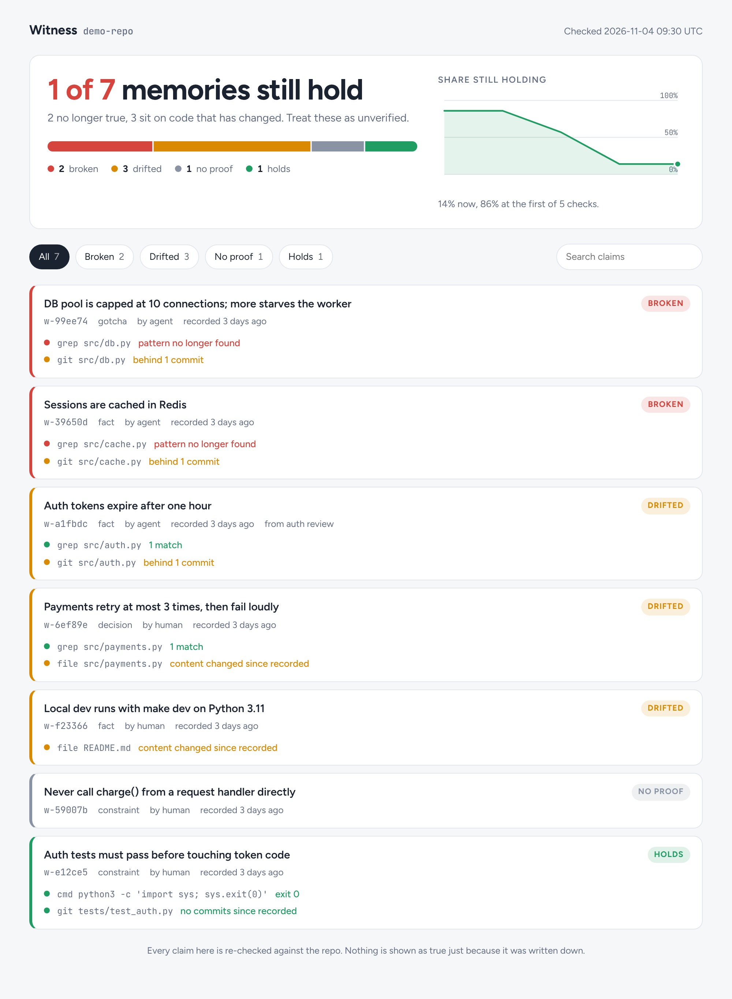
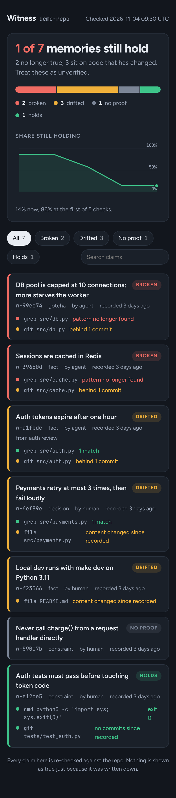

# witness

Agent memory where every claim carries its own proof.

Most memory tools store a sentence and trust it forever. witness stores the sentence
plus small checks (witnesses) against the repo, and re-runs them. A remembered claim is
shown as true only if its proof still holds.

## What it looks like

`witness report` writes one self-contained HTML file. Claims are sorted worst first, and each one shows the proof it was checked against. The colour bar and the trend line show at a glance how much of your agent's memory still holds.

<p align="center">
  
  &nbsp;
  
</p>

Those are from the demo repo (`examples/demo.sh`), where the code was changed under the remembered claims. In a terminal, `witness check` prints the same information:

```
BROKEN      w-99ee74  DB pool is capped at 10 connections; more starves the worker
            grep:src/db.py  pattern no longer found
            git:src/db.py  behind 1 commit
DRIFTED     w-a1fbdc  Auth tokens expire after one hour
            git:src/auth.py  behind 1 commit
FRESH       w-e12ce5  Auth tests must pass before touching token code
```

One file, Python 3.8+, standard library only, works on Windows, macOS and Linux.

## Use

```bash
python witness.py add "Auth tokens expire after one hour" --kind fact --author agent \
    -w grep:src/auth.py:'TOKEN_TTL_SECONDS = 3600' -w git:src/auth.py
python witness.py check            # re-run every witness; exit 1 if any claim is broken
python witness.py report -o witness-report.html   # the visual dashboard
python witness.py brief            # short digest for an agent at session start
python witness.py ack w-a1fbdc     # you confirmed a drifted claim by hand: re-baseline it
```

| Witness | Proves | Goes bad when |
|---|---|---|
| `file:PATH[#10-20]` | the file (or line range) is unchanged | content changes (drifted), file deleted (broken) |
| `grep:PATH:REGEX` | the pattern still appears | pattern gone (broken) |
| `git:PATH` | no commits touched the path since the claim | commits land (drifted, "behind N") |
| `cmd:COMMAND` | a command still exits 0 | exits non-zero (broken); only runs with `--allow-cmd` |

Claim states, worst first: **broken**, **drifted**, **unchecked**, **no proof**, **holds**.

## Wire it into an agent

Claude Code, in `~/.claude/settings.json` (user level):

```json
{ "hooks": { "SessionStart": [ { "matcher": "startup|resume|clear|compact",
  "hooks": [ { "type": "command", "command": "python /path/to/witness.py brief" } ] } ] } }
```

Hermes Agent has no hook that injects text once at session start (only `pre_llm_call`,
every turn), so use an instruction in the first of `.hermes.md`, `AGENTS.override.md`,
`AGENTS.md` or `CLAUDE.md`:

```
- At session start run `python /path/to/witness.py brief` and re-verify anything flagged before relying on it.
```

That relies on the model following the instruction. It is untested on Hermes.

## Design choices (from the research)

- Plain files in `.witness/` (an append-only event log), no server, no model, no API key.
- The brief re-checks live, so the digest can never be older than the code.
- Witnesses never execute anything by default. A store you cloned is treated as code:
  `cmd` witnesses need `--allow-cmd`, and paths outside the repo are refused.
- A torn or hostile line in the log is skipped, not fatal.
- Every `check` appends to `history.jsonl`, which feeds the dashboard trend and is the
  raw material for measuring whether this helps (see below).

## Known limits

- A passing witness proves the code still says X, not that X is the right thing to believe.
- Claims with no witness are listed as "no proof" and never promoted.
- Event log appends are not locked. Two sessions writing the same instant could tear a
  line (skipped on read). Fine for one person's sessions, not hardened for teams.
- No outcome evidence yet. The research found none for any memory tool.

## How to find out if it helps

Run the same multi-session coding task with (a) no memory, (b) a plain notes file,
(c) witness. Seed claims, change the code between sessions so some go stale, and
score: tasks completed, stale claims acted on, tokens spent. The stale-claims-acted-on
number is where witness should win, and where the notes file should lose.

## License

MIT, see [LICENSE](LICENSE).
